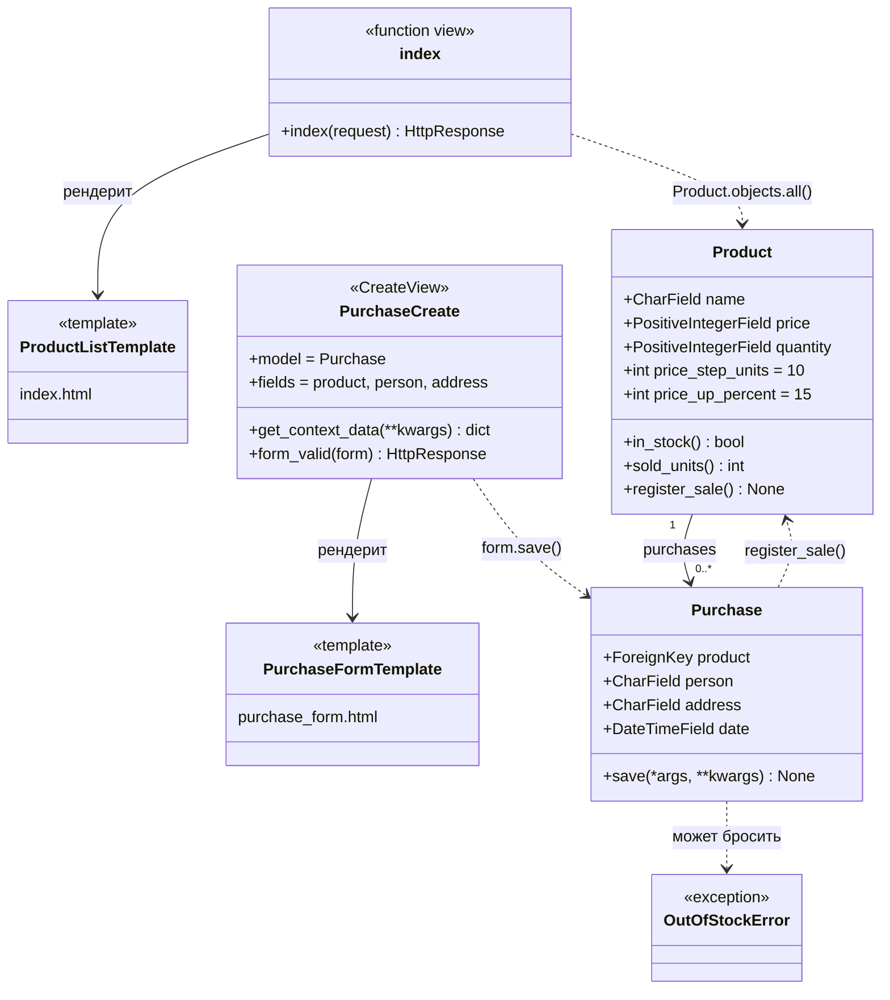
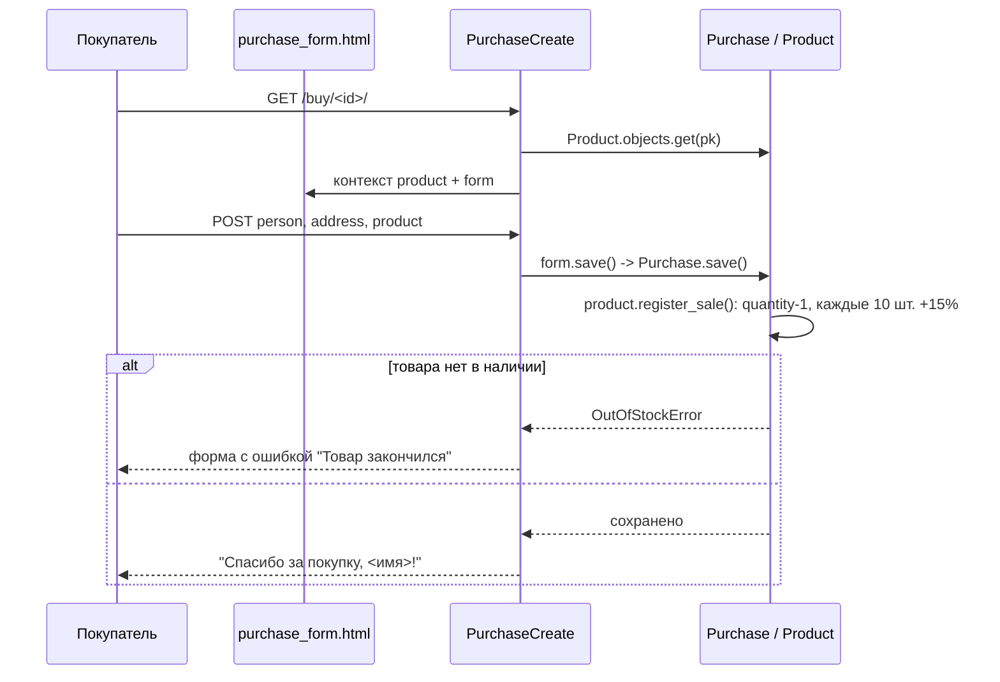

# Лабораторная 2 по дисциплине "Технологии программирования"

[](https://github.com/Klaw271/PTLab2/actions/workflows/github-actions-testing.yml)

Разработка веб-приложения по шаблону MVC (Django) с настроенными конвейерами
непрерывной интеграции (CI) и непрерывного развёртывания (CD).

## Постановка задачи

Проект `PTLab2` — интернет-магазин на Django: список товаров, оформление покупки
покупателем, хранение покупок в базе данных. Необходимо:

1. форкнуть репозиторий лабораторной работы и запустить проект локально
   (PostgreSQL, миграции, фикстуры, тесты);
2. настроить CI — автоматический запуск линтера и тестов при каждом пуше
   (в методических указаниях — Travis CI);
3. настроить CD — автоматическое развёртывание приложения на хостинге
   (в методических указаниях — Heroku);
4. выполнить индивидуальное задание (вариант 8): **магазин электроники** —
   в магазине имеется определённое количество товара каждого вида, после покупки
   10 экземпляров любого товара (возможно, разными покупателями) его цена
   возрастает на 15 %;
5. оформить лицензию, `.gitignore`, README с UML-диаграммой и выводами.

Замена сервисов. Бесплатные тарифы, на которых построена методичка, закрыты:
Travis CI с 2021 года не даёт бесплатные минуты open-source проектам, а Heroku
с ноября 2022 года не имеет бесплатных тарифов. Пункт 3 индивидуального задания
допускает выбор альтернативных инструментов, поэтому использованы:

| По методичке | В работе | Причина |
|---|---|---|
| Travis CI | GitHub Actions | бесплатные 2000 минут/мес для публичных репозиториев, сервис БД поднимается прямо в job |
| Heroku | Render | бесплатный persistent service с PostgreSQL, развёртывание из GitHub при пуше в `master` |

## Индивидуальное задание, вариант 8

Модель `Product` дополнена полем `quantity` — количество экземпляров на складе
(задаётся фикстурой). Правило цены реализовано в `Product.register_sale()`:

```python
price_step_units = 10   # каждые 10 проданных экземпляров
price_up_percent = 15   # повышают цену на 15 %

self.quantity -= 1
if (self.sold_units() + 1) % self.price_step_units == 0:
    self.price += self.price * self.price_up_percent // 100
```

`sold_units()` — число уже оформленных покупок этого товара (`Purchase` связан с
`Product` через `related_name='purchases'`), поэтому счётчик «не забывает»
историю и повышение происходит и на 10-м, и на 20-м экземпляре. Цена —
целочисленная, повышение округляется вниз: 30000 → 34500 → 39617.

`Purchase.save()` вызывает `register_sale()` только при создании новой записи
(`self.pk is None`), поэтому редактирование уже сохранённой покупки не списывает
склад. Если товар закончился, бросается `OutOfStockError`; в представлении он
превращается в ошибку поля формы, а шаблоны не предлагают «Купить» для товара
с `quantity == 0`.

Примеры проверок из тестов:

```text
10 продаж Смартфона по 1000  →  1150   (цена поднялась один раз)
20 продаж Смартфона по 1000  →  1322   (1150 + 15 %, округление вниз)
9 продаж                     →  1000   (правило не сработало досрочно)
продажа при quantity == 0    →  OutOfStockError, запись не создана
```

## Краткое описание проекта

```
PTLab2
  |----.github/workflows/github-actions-testing.yml   # CI
  |----render.yaml                                    # CD (blueprint Render)
  |----Procfile                                       # запуск web-процесса
  |----shop
  |     |----models.py              # Model: Product, Purchase, OutOfStockError
  |     |----views.py               # Controller: index, PurchaseCreate
  |     |----urls.py                # маршруты /, /buy/<product_id>/
  |     |----admin.py
  |     |----fixtures/products.yaml # стартовые товары магазина электроники
  |     |----migrations/
  |     |----templates/shop/
  |     |      |----index.html           # View: список товаров и остатков
  |     |      |----purchase_form.html   # View: форма покупки
  |     |----tests/
  |            |----test_models.py       # тесты моделей (база)
  |            |----test_views.py        # тесты представлений
  |            |----test_stock.py        # тесты варианта 8
  |----tplab2/settings.py               # БД, STATIC, ALLOWED_HOSTS, django-heroku
  |----manage.py
  |----requirements.txt
  |----LICENSE
  |----README.md
```

Соответствие шаблону MVC:

| Роль MVC | Реализация в проекте |
|---|---|
| Model | `shop/models.py` — `Product`, `Purchase`; бизнес-правило варианта 8 живёт здесь, а не в представлении |
| View | `shop/templates/shop/*.html` — шаблоны, только отображение и разметка |
| Controller | `shop/views.py` — `index()` и `PurchaseCreate` (CreateView): читают модели, выбирают шаблон, обрабатывают POST |

## Используемые языки, библиотеки и технологии

- Python 3.10 (локально 3.12), Django 3.2.25 — веб-фреймворк (MTV/MVC);
- PostgreSQL 17 локально (установлен через `winget`), `psycopg2` — драйвер;
- `pyyaml` — фикстуры товаров в YAML, `django loaddata`;
- тестирование: `django.test.TestCase` и `Client` (23 теста), проверка PEP8 —
  `pycodestyle`;
- Git, GitHub, GitHub Actions — версии и CI;
- `dj-database-url`, `whitenoise`, `gunicorn`, `django-heroku`, Render — запуск
  продактив-сборки; `render.yaml` — декларативное описание сервиса и БД.

## UML-диаграмма классов



Диаграмма последовательности оформления покупки:



## Ход работы

1. Окружение и запуск локально:

   ```powershell
   winget install PostgreSQL.PostgreSQL     # пароль superuser: ps_password
   psql -c "create database django_db owner postgres;" -U postgres
   python -m venv .venv-tplab2 && .venv-tplab2\Scripts\Activate.ps1
   pip install -r requirements.txt
   $env:DATABASE_PASSWORD = "ps_password"
   python manage.py migrate
   python manage.py loaddata products.yaml
   python manage.py runserver
   python manage.py test shop          # 23 tests OK
   pycodestyle shop --exclude=migrations
   ```

   `settings.py` читает пароль из `DATABASE_PASSWORD`, а `DATABASE_URL` (Render)
   обрабатывает `dj-database-url`; в `ALLOWED_HOSTS` добавлены `localhost` и
   `127.0.0.1`, чтобы `DEBUG = False` не мешал локальному запуску.

2. Работа с Git: форк `kpdvstu/PTLab2` → `Klaw271/PTLab2`, настройка
   `user.name` / `user.email`, ветка `feature/variant8-electronics`, разработка
   варианта 8 и тестов в ней, затем `git merge --no-ff` в `master` и пуш.
3. CI (GitHub Actions): workflow `Testing the Python code` поднимает сервис
   `postgres:13`, ставит зависимости, запускает `pycodestyle`, применяет
   миграции, загружает фикстуры и выполняет `python manage.py test shop/tests/`.
4. Проверка реакции CI: намеренная ошибка в правиле цены → красный билд →
   `git revert` → зелёный билд (таблица ниже).
5. CD (Render): `render.yaml` описывает web-сервис `tplab2-electronics-shop`
   (python, gunicorn, `collectstatic`, `migrate`, `loaddata`) и бесплатную
   PostgreSQL-БД, из которой в сервис передаётся `DATABASE_URL`. Подключённый
   GitHub-репозиторий разворачивает приложение при каждом пуше в `master`.

### Проверка реакции CI

Эксперимент выполнялся в ветке `feature/variant8-electronics`, чтобы красные
прогоны не попадали в `master`, из которого работает CD.

| Прогон | Коммит | Изменение | Результат workflow |
|--------|--------|-----------|--------------------|
| [#1](https://github.com/Klaw271/PTLab2/actions/runs/38731828455) | `60278d7` | базовое состояние варианта 8 | `success`: lint, миграции, фикстуры, 23 теста |
| [#2](https://github.com/Klaw271/PTLab2/actions/runs/38732063780) | `db82140` | `price_up_percent` заменён с `15` на `5` | `failure` на шаге `Test with Django` (4 теста: `1050 != 1150`, `1102 != 1322`, `1048 != 1148`), линтер — успешен |
| [#3](https://github.com/Klaw271/PTLab2/actions/runs/38732707497) | `483bc94` | `git revert` предыдущего коммита | `success` |

Ошибка в проценте повышения цены не портит работу приложения «на глаз» (товар
всё так же продаётся, цена всё так же растёт), но меняет бизнес-правило варианта,
и её ловят модульные тесты в CI, а не пользователь на хостинге.

## Теоретические вопросы

1. **Архитектурный шаблон MVC.** Модель хранит данные и бизнес-правила,
   представление (View в классическом MVC — то, что в Django называется
   шаблоном) отвечает за вывод, контроллер принимает запрос, обращается к модели
   и выбирает представление. Преимущество разделения — правила не дублируются в
   интерфейсе, код легче тестировать: `register_sale()` проверяется без браузера.
2. **Django и «MTV».** Django трактует шаблон как Model-Template-View: *view*
   у него — контроллер (функция или `generic View`), а роль V из MVC выполняет
   шаблон. Маршрутизация — `urls.py`: URL сопоставляется представлению,
   параметры (например, `<int:product_id>`) передаются в `kwargs`.
3. **ORM, миграции, фикстуры.** Модели — классы-наследники `models.Model`;
   `makemigrations` формирует описание изменений схемы (`0002_product_quantity`),
   `migrate` применяет их к PostgreSQL. Фикстуры (`fixtures/products.yaml`)
   заполняют БД тестовыми данными через `loaddata`, что позволяет CI и хостингу
   получать одинаковый набор товаров.
4. **CI и Travis CI.** Непрерывная интеграция запускает сборку и тесты на
   чистой машине при каждом пуше. Travis CI описывается файлом `.travis.yml`
   (`language`, `services: postgresql`, `install`, `script`, `deploy`) и был
   заменён на GitHub Actions, где тот же конвейер задаётся workflow в
   `.github/workflows`, а сервис базы данных объявляется в секции `services`.
5. **Хостинг и CD.** PaaS-платформа (Heroku, Render) собирает приложение по
   `requirements.txt`, задаёт переменные окружения и запускает процесс из
   `Procfile` (`web: gunicorn tplab2.wsgi`). Отличия продактив-настройки от
   локальной: `DEBUG = False`, статика отдаёт `whitenoise`, БД берётся из
   `DATABASE_URL`, секреты (`SECRET_KEY`, пароль БД) приходят только из
   переменных окружения и не попадают в репозиторий.
6. **Автоматическое развёртывание.** CD-триггер — пуш в `master`: CI сначала
   проверяет тесты, затем конвейер собирает и выкладывает релиз. Это делает
   поставку рутинной (нет ручной сборки на сервере) и безопасной: неработающая
   ветка не доходит до продакшена, а откат — это `git revert` плюс новый пуш.

## Выводы

Изучен шаблон MVC на реальном веб-приложении: бизнес-правило варианта 8
(остаток на складе и повышение цены на 15 % после каждых 10 проданных
экземпляров) размещено в модели, контроллер только разбирает запрос и
обрабатывает `OutOfStockError`, шаблоны ничего не знают о правиле цены. Такое
разделение позволило покрыть правило 10 тестами на уровне моделей и проверить
ещё 8 сценариев через `django.test.Client`, включая граничные случаи
(9 продаж — цена прежняя, 20 продаж — цена повышена дважды, покупка
закончившегося товара не создаёт запись).

Освоен полный конвейер: локальное окружение с PostgreSQL, миграции и фикстуры,
CI на GitHub Actions с настоящей базой данных в сервисе контейнера, CD на Render
через декларативный `render.yaml`. Эксперимент с намеренной ошибкой показал, что
конвейер блокирует попадание неработающего кода в `master` и в развёрнутое
приложение. Отрицательные стороны, отмеченные на практике: требования методички
(Travis CI, Heroku) устарели — бесплатные тарифы закрыты, приходится подбирать
заменители и вручную сверять поведение сервисов; на бесплатном Render тарифе
приложение «засыпает» без запросов, а первая проверка миграций занимает несколько
минут, тогда как локальный прогон тестов укладывается в секунды.
