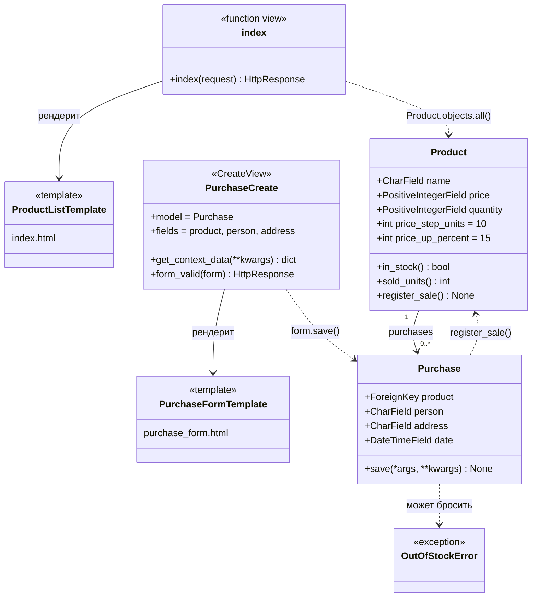
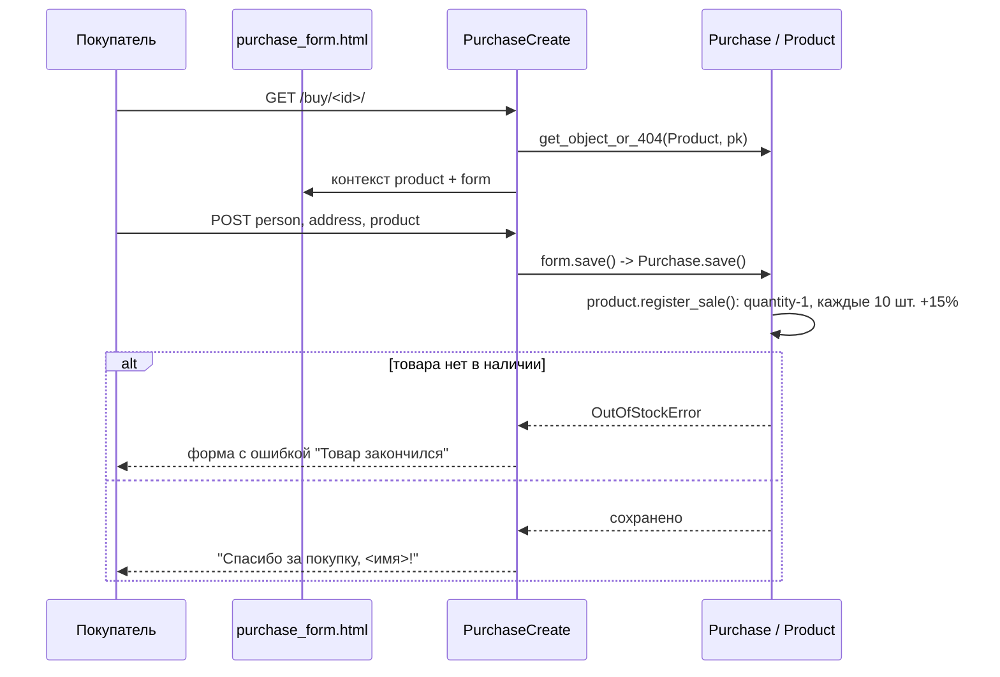

# Лабораторная 2 по дисциплине "Технологии программирования"

[](https://github.com/Klaw271/PTLab2/actions/workflows/github-actions-testing.yml)

Разработка веб-приложения по шаблону MVC (Django) с настроенными конвейерами
непрерывной интеграции (CI) и непрерывного развёртывания (CD).

Работающее приложение: <https://tplab2-electronics-shop.onrender.com/>
(развёрнуто на Render из ветки `master`, см. раздел «Развёртывание вручную»).

## Постановка задачи

Проект `PTLab2` — интернет-магазин на Django: список товаров, оформление покупки
покупателем, хранение покупок в базе данных. Необходимо:

1. форкнуть репозиторий лабораторной работы и запустить проект локально
   (PostgreSQL, миграции, фикстуры, тесты);
2. настроить CI — автоматический запуск линтера и тестов при каждом пуше
   (в методических указаниях — Travis CI);
3. настроить CD — автоматическое развёртывание приложения на хостинге
   (в методических указаниях — Heroku);
4. выполнить индивидуальное задание (вариант 8): **магазин электроники** —
   в магазине имеется определённое количество товара каждого вида, после покупки
   10 экземпляров любого товара (возможно, разными покупателями) его цена
   возрастает на 15 %;
5. оформить лицензию, `.gitignore`, README с UML-диаграммой и выводами.

Замена сервисов. Бесплатные тарифы, на которых построена методичка, закрыты:
Travis CI с 2021 года не даёт бесплатные минуты open-source проектам, а Heroku
с ноября 2022 года не имеет бесплатных тарифов. Пункт 3 индивидуального задания
допускает выбор альтернативных инструментов, поэтому использованы:

| По методичке | В работе | Причина |
|---|---|---|
| Travis CI | GitHub Actions | бесплатные 2000 минут/мес для публичных репозиториев, сервис БД поднимается прямо в job |
| Heroku | Render | бесплатный persistent service с PostgreSQL, развёртывание из GitHub при пуше в `master` |

## Индивидуальное задание, вариант 8

Модель `Product` дополнена полем `quantity` — количество экземпляров на складе
(задаётся фикстурой). Правило цены реализовано в `Product.register_sale()`:

```python
price_step_units = 10   # каждые 10 проданных экземпляров
price_up_percent = 15   # повышают цену на 15 %

self.quantity -= 1
if (self.sold_units() + 1) % self.price_step_units == 0:
    self.price += self.price * self.price_up_percent // 100
```

`sold_units()` — число уже оформленных покупок этого товара (`Purchase` связан с
`Product` через `related_name='purchases'`), поэтому счётчик «не забывает»
историю и повышение происходит и на 10-м, и на 20-м экземпляре. Цена —
целочисленная, повышение округляется вниз: 30000 → 34500 → 39617.

`Purchase.save()` вызывает `register_sale()` только при создании новой записи
(`self.pk is None`), поэтому редактирование уже сохранённой покупки не списывает
склад. Если товар закончился, бросается `OutOfStockError`; в представлении он
превращается в ошибку поля формы, а шаблоны не предлагают «Купить» для товара
с `quantity == 0`.

Примеры проверок из тестов:

```text
10 продаж Смартфона по 1000  →  1150   (цена поднялась один раз)
20 продаж Смартфона по 1000  →  1322   (1150 + 15 %, округление вниз)
9 продаж                     →  1000   (правило не сработало досрочно)
продажа при quantity == 0    →  OutOfStockError, запись не создана
```

## Краткое описание проекта

```
PTLab2
  |----.github/workflows/github-actions-testing.yml   # CI
  |----.coveragerc                                    # полнота: shop, без миграций и тестов
  |----render.yaml                                    # CD (blueprint Render)
  |----Procfile                                       # запуск web-процесса
  |----shop
  |     |----models.py              # Model: Product, Purchase, OutOfStockError
  |     |----views.py               # Controller: index, PurchaseCreate
  |     |----urls.py                # маршруты /, /buy/<product_id>/
  |     |----admin.py
  |     |----fixtures/products.yaml # стартовые товары магазина электроники
  |     |----migrations/
  |     |----templates/shop/
  |     |      |----index.html           # View: список товаров и остатков
  |     |      |----purchase_form.html   # View: форма покупки
  |     |----tests/
  |            |----test_models.py       # тесты моделей (база)
  |            |----test_views.py        # тесты представлений
  |            |----test_stock.py        # тесты варианта 8
  |            |----test_unit_stock.py   # юнит-тесты правила с двойниками
  |            |----test_forms.py        # валидация полей и формы покупки
  |            |----test_urls.py         # маршрутизация: resolve и reverse
  |            |----test_rendering.py    # контекст представлений и шаблонов
  |            |----test_fixtures.py     # контракт стартовых фикстур
  |----tplab2/settings.py               # БД, STATIC, ALLOWED_HOSTS, django-heroku
  |----manage.py
  |----requirements.txt
  |----LICENSE
  |----README.md
```

Соответствие шаблону MVC:

| Роль MVC | Реализация в проекте |
|---|---|
| Model | `shop/models.py` — `Product`, `Purchase`; бизнес-правило варианта 8 живёт здесь, а не в представлении |
| View | `shop/templates/shop/*.html` — шаблоны, только отображение и разметка |
| Controller | `shop/views.py` — `index()` и `PurchaseCreate` (CreateView): читают модели, выбирают шаблон, обрабатывают POST |

## Используемые языки, библиотеки и технологии

- Python 3.10 (локально 3.12), Django 3.2.25 — веб-фреймворк (MTV/MVC);
- PostgreSQL 17 локально (установлен через `winget`), `psycopg2` — драйвер;
- `pyyaml` — фикстуры товаров в YAML, `django loaddata`;
- тестирование: `django.test.TestCase`/`SimpleTestCase` и `Client` (69 тестов),
  двойники из `unittest.mock`, полнота и её порог в CI — `coverage`, проверка
  PEP8 — `pycodestyle`;
- Git, GitHub, GitHub Actions — версии и CI;
- `dj-database-url`, `whitenoise`, `gunicorn`, `django-heroku`, Render — запуск
  продактив-сборки; `render.yaml` — декларативное описание сервиса и БД.

## UML-диаграмма классов



Диаграмма последовательности оформления покупки:



## Ход работы

1. Окружение и запуск локально:

   ```powershell
   winget install PostgreSQL.PostgreSQL     # superuser и его задаём сами
   psql -c "create database django_db owner postgres;" -U postgres
   python -m venv .venv-tplab2 && .venv-tplab2\Scripts\Activate.ps1
   pip install -r requirements.txt
   $env:DATABASE_PASSWORD = "<пароль superuser>"   # только локально, не в git
   python manage.py migrate
   python manage.py loaddata products.yaml
   python manage.py runserver
   python manage.py test shop          # 69 tests OK
   pycodestyle shop --exclude=migrations
   ```

   `settings.py` читает пароль из `DATABASE_PASSWORD`, а `DATABASE_URL` (Render)
   обрабатывает `dj-database-url`; в `ALLOWED_HOSTS` добавлены `localhost` и
   `127.0.0.1`, чтобы `DEBUG = False` не мешал локальному запуску.

2. Работа с Git: форк `kpdvstu/PTLab2` → `Klaw271/PTLab2`, настройка
   `user.name` / `user.email`, ветка `feature/variant8-electronics`, разработка
   варианта 8 и тестов в ней, затем `git merge --no-ff` в `master` и пуш.
3. CI (GitHub Actions): workflow `Testing the Python code` поднимает сервис
   `postgres:13`, ставит зависимости, запускает `pycodestyle`, применяет
   миграции, загружает фикстуры и выполняет `coverage run manage.py test
   shop/tests/`; шаг `Enforce test coverage` проверяет `coverage report
   --fail-under=100`, то есть конвейер падает, если тесты перестают покрывать
   модули `shop` полностью. Файл `.travis.yml` оставлен в репозитории как
   конфигурация по методичке, но конвейер на Travis не активирован.
4. Проверка реакции CI: намеренная ошибка в правиле цены → красный билд →
   `git revert` → зелёный билд (таблица ниже).
5. CD (Render): `render.yaml` описывает web-сервис `tplab2-electronics-shop`
   (python, `pip install`, `collectstatic`, `migrate`, запуск через `gunicorn`)
   и бесплатную PostgreSQL-БД, чей `DATABASE_URL` передаётся сервису; секреты
   (`SECRET_KEY`) генерируются Render и не хранятся в репозитории. Подключённый
   GitHub-репозиторий разворачивает приложение при каждом пуше в `master`.

### Развёртывание вручную (однократно)

1. Render → *New* → *Blueprint*: репозиторий `Klaw271/PTLab2`, файл `render.yaml`
   (Render сам предложит авторизовать GitHub-приложение Blueprint — доступ
   разрешён только для этого репозитория).
2. Заполнить каталог стартовыми товарами: `python manage.py loaddata
   products.yaml`. Фикстуры намеренно не включены в `buildCommand`: `loaddata`
   перезаписывает `price` и `quantity` товаров с фиксированными `pk`, и каждый
   новый деплой обнулял бы накопленные покупки и повышения цен.
   На бесплатном тарифе вычислений встроенная в панель *Shell* команда недоступна
   («Shell is not supported for free compute plans»), поэтому фикстуры загружены
   один раз с локальной машины по внешнему подключению к БД — строка
   *External Database URL* страницы базы данных передана только через переменную
   окружения `DATABASE_URL` и в репозиторий не попала:

   ```powershell
   $env:DATABASE_URL = "<External Database URL из панели Render>"
   python manage.py loaddata products.yaml   # Installed 4 object(s)
   ```

3. Проверка на `https://tplab2-electronics-shop.onrender.com/`: список из 4
   товаров, покупка уменьшает остаток, десятая продажа поднимает цену на 15 %.
   Проверено на живом деплое серией из 10 покупок товара «Наушники»: остаток
   `30 → 20`, цена `3000 → 3450`.
4. Ограничение бесплатного тарифа: БД `electronics-shop-db` истекает
   14.11.2026 (панель базы данных предлагает продлить переходом на платный
   тариф), а сервис без запросов «засыпает» — первая страница после простоя
   открывается несколько десятков секунд.

### Проверка реакции CI

Эксперимент выполнялся в ветке `feature/variant8-electronics`, чтобы красные
прогоны не попадали в `master`, из которого работает CD.

| Прогон | Коммит | Изменение | Результат workflow |
|--------|--------|-----------|--------------------|
| [#1](https://github.com/Klaw271/PTLab2/actions/runs/38731828455) | `60278d7` | базовое состояние варианта 8 | `success`: lint, миграции, фикстуры, 23 теста |
| [#2](https://github.com/Klaw271/PTLab2/actions/runs/38732063780) | `db82140` | `price_up_percent` заменён с `15` на `5` | `failure` на шаге `Test with Django` (4 теста: `1050 != 1150`, `1102 != 1322`, `1048 != 1148`), линтер — успешен |
| [#3](https://github.com/Klaw271/PTLab2/actions/runs/38732707497) | `483bc94` | `git revert` предыдущего коммита | `success` |
| [#4](https://github.com/Klaw271/PTLab2/actions/runs/38733132049) | `885dea2` | merge `--no-ff` ветки в `master` | `success`, запускает CD |
| [#5](https://github.com/Klaw271/PTLab2/actions/runs/38733589513) | `6afed9b` | фикстуры вынесены из `buildCommand` | `success` |
| [#6](https://github.com/Klaw271/PTLab2/actions/runs/41621824172) | `28a32c8` | ветка `feature/variant8-unit-tests`: юнит-тесты ЛР3 и их описание | `success`: lint, миграции, фикстуры, 67 тестов |
| [#7](https://github.com/Klaw271/PTLab2/actions/runs/41622010417) | `498aed6` | merge `--no-ff` этой ветки в `master` | `success`, запускает CD |

Ошибки в правиле цены не портят работу приложения «на глаз» (товар всё так же
продаётся, цена всё так же растёт), но меняют бизнес-правило варианта, и их
ловят модульные тесты в CI, а не пользователь на хостинге. Все прогоны после
мержа ветки варианта в `master` (`0a13762`, `f2e346a` и последующие)
завершались со статусом `success`.

## Юнит-тесты (лабораторная работа 3)

Задача работы — покрыть юнит-тестами проект, разработанный в ЛР2. Тесты
добавлены в `shop/tests` этого же репозитория и запускаются тем же конвейером,
что и тесты ЛР2.

### Что проверяет каждый файл

| Файл | Тестов | Проверяемый слой |
|------|--------|------------------|
| `test_models.py` | 4 | типы и значения полей `Product` и `Purchase` (из ЛР2) |
| `test_stock.py` | 10 | правило варианта 8 на реальном объекте модели (из ЛР2) |
| `test_unit_stock.py` | 11 | та же логика, но изолированно: `SimpleTestCase` и `unittest.mock` |
| `test_views.py` | 9 | покупки через веб-интерфейс `Client` (из ЛР2) |
| `test_rendering.py` | 11 | имя шаблона, состав контекста, реакции на некорректный POST и `404` для несуществующего товара |
| `test_forms.py` | 13 | валидация полей `Product` (`full_clean`) и формы `Purchase` |
| `test_urls.py` | 6 | `resolve`/`reverse`, несуществующие адреса через `Resolver404` |
| `test_fixtures.py` | 5 | контракт `products.yaml`: цены, остатки, уникальность имён, продажа |
| **Итого** | **69** | |

`test_unit_stock.py` отличается от `test_stock.py` способом подготовки
объекта: товар создаётся несейвленным, `sold_units()` и `save()` подменяются
двойниками, а `Model.save` патчится целиком. Такой тест не зависит от базы
данных и выполняется за миллисекунды (`Skipping setup of unused database(s)`),
зато проверяет ровно арифметику правила: списание остатка, момент повышения
цены, округление вниз, запрет продажи без склада и то, что повторное
сохранение уже существующей покупки не засчитывает вторую продажу.

Форма покупки нигде в проекте не объявлена явно — её строит `CreateView` из
`fields = ['product', 'person', 'address']`, поэтому тесты формы получают её
тем же способом (`modelform_factory`) и проверяют обязательность имени и
адреса, обязательность товара, отказ на несуществующем `pk` и то, что дата
заполняется моделью (`auto_now_add`), а не формой.

### Запуск и полнота

Параметры измерения вынесены в `.coveragerc` (`source = shop`, без миграций и
самих тестов), поэтому локальный прогон и конвейер используют одну и ту же
конфигурацию:

```powershell
python manage.py test shop                              # 69 tests OK
python -m pycodestyle shop --exclude=migrations         # PEP8
python -m coverage run manage.py test shop
python -m coverage report -m --fail-under=100
```

Шаги `Test with Django` и `Enforce test coverage` в workflow повторяют эти две
команды, так что пуш с тестами, не покрывающими `shop` полностью, не пройдёт
конвейер.

| Модуль | Операторы | Не покрыто | Полнота |
|--------|-----------|------------|---------|
| `shop/models.py` | 28 | 0 | 100 % |
| `shop/views.py` | 22 | 0 | 100 % |
| `shop/urls.py` | 3 | 0 | 100 % |
| `shop/apps.py` | 4 | 0 | 100 % |
| `shop/admin.py` | 1 | 0 | 100 % |
| **Итого (без миграций и самих тестов)** | **58** | **0** | **100 %** |

### Проверка чувствительности тестов

Полнота по операторам не доказывает, что тесты что-то проверяют, поэтому для
каждой из шести мутаций запускались 46 тестов, относящихся к правилу варианта 8
и к странице покупки (`test_unit_stock`, `test_stock`, `test_fixtures`,
`test_views`, `test_rendering`), после чего файл восстанавливался; контрольная
сумма файла до и после прогона совпадает.

| Мутация | Упало тестов | Поймана |
|---------|--------------|---------|
| `models.py`: `price_up_percent = 15` → `5` | 8 | да |
| `models.py`: условие `… % price_step_units == 0` → `if True` (цена растёт всегда) | 7 | да |
| `models.py`: `self.quantity -= 1` → `+= 1` (остаток растёт) | 11 | да |
| `models.py`: проверка остатка `if not self.in_stock():` → `if False` | 2 + 4 ошибки | да |
| `models.py`: `if self.pk is None:` → `if True` (продажа засчитывается и при обновлении) | 1 | да |
| `views.py`: `get_object_or_404` → `Product.objects.get` (возврат 500 вместо `404`) | 1 + 2 ошибки | да |

Ни одна из мутаций не меняет поведение приложения «на глаз» — магазин
продолжает продавать товары, — но каждая ломает бизнес-правило варианта или
соглашение об ошибках, и её ловит хотя бы один тест.

Последняя строка таблицы — не только про тесты: найденный при написании набора
недостаток (страница `/buy/<id>/` для несуществующего идентификатора падала с
`Product.DoesNotExist` вместо `404`) исправлен в `views.py` переходом на
`get_object_or_404`, а поведение закреплено двумя тестами в `test_rendering.py`
— `GET` и `POST` несуществующего товара дают `404`, и покупка при этом не
создаётся.


## Теоретические вопросы

1. **Архитектурный шаблон MVC.** Модель хранит данные и бизнес-правила,
   представление (View в классическом MVC — то, что в Django называется
   шаблоном) отвечает за вывод, контроллер принимает запрос, обращается к модели
   и выбирает представление. Преимущество разделения — правила не дублируются в
   интерфейсе, код легче тестировать: `register_sale()` проверяется без браузера.
2. **Django и «MTV».** Django трактует шаблон как Model-Template-View: *view*
   у него — контроллер (функция или `generic View`), а роль V из MVC выполняет
   шаблон. Маршрутизация — `urls.py`: URL сопоставляется представлению,
   параметры (например, `<int:product_id>`) передаются в `kwargs`.
3. **ORM, миграции, фикстуры.** Модели — классы-наследники `models.Model`;
   `makemigrations` формирует описание изменений схемы (`0002_product_quantity`),
   `migrate` применяет их к PostgreSQL. Фикстуры (`fixtures/products.yaml`)
   заполняют БД тестовыми данными через `loaddata`, что позволяет CI и хостингу
   получать одинаковый набор товаров.
4. **CI и Travis CI.** Непрерывная интеграция запускает сборку и тесты на
   чистой машине при каждом пуше. Travis CI описывается файлом `.travis.yml`
   (`language`, `services: postgresql`, `install`, `script`, `deploy`) и был
   заменён на GitHub Actions, где тот же конвейер задаётся workflow в
   `.github/workflows`, а сервис базы данных объявляется в секции `services`.
5. **Хостинг и CD.** PaaS-платформа (Heroku, Render) собирает приложение по
   `requirements.txt`, задаёт переменные окружения и запускает процесс из
   `Procfile` (`web: gunicorn tplab2.wsgi`). Отличия продактив-настройки от
   локальной: `DEBUG = False`, статика отдаёт `whitenoise`, БД берётся из
   `DATABASE_URL`, секреты (`SECRET_KEY`, пароль БД) приходят только из
   переменных окружения и не попадают в репозиторий.
6. **Автоматическое развёртывание.** CD-триггер — пуш в `master`: CI сначала
   проверяет тесты, затем конвейер собирает и выкладывает релиз. Это делает
   поставку рутинной (нет ручной сборки на сервере) и безопасной: неработающая
   ветка не доходит до продакшена, а откат — это `git revert` плюс новый пуш.
7. **Юнит-тестирование.** Юнит-тест проверяет одну единицу поведения — метод или
   правило — независимо от остальных частей системы. В Django три уровня:
   `SimpleTestCase` (логика без базы данных; попытка обратиться к БД считает
   тест упавшим), `TestCase` (каждый тест в транзакции на отдельной тестовой
   базе, отсюда изоляция и воспроизводимость) и `TestCase` с `Client` — вызов
   представления через HTTP без запущенного сервера. Зависимости, которые
   дороже самого теста (запись в базу, счётчик продаж), подменяют двойниками из
   `unittest.mock`: `Mock` фиксирует, был ли метод вызван и с какими
   аргументами, поэтому тест может проверить не только результат, но и
   взаимодействие — например, что `register_sale()` вызывает `save()` ровно
   один раз, а повторное сохранение уже созданной покупки его не вызывает
   вовсе. Полноту измеряют coverage'ом по операторам, но 100 % не означают
   работоспособности проверок: пустой тест тоже покрывает строку. Чувствительность
   набора проверяют мутациями — в код вносят небольшое искажение правила и
   смотрят, упадут ли тесты.

## Выводы

Изучен шаблон MVC на реальном веб-приложении: бизнес-правило варианта 8
(остаток на складе и повышение цены на 15 % после каждых 10 проданных
экземпляров) размещено в модели, контроллер только разбирает запрос и
обрабатывает `OutOfStockError`, шаблоны ничего не знают о правиле цены. Такое
разделение позволило покрыть правило 10 тестами на уровне моделей и проверить
ещё 8 сценариев через `django.test.Client`, включая граничные случаи
(9 продаж — цена прежняя, 20 продаж — цена повышена дважды, покупка
закончившегося товара не создаёт запись).

Освоен полный конвейер: локальное окружение с PostgreSQL, миграции и фикстуры,
CI на GitHub Actions с настоящей базой данных в сервисе контейнера, CD на Render
через декларативный `render.yaml`. Эксперимент с намеренной ошибкой показал, что
конвейер блокирует попадание неработающего кода в `master` и в развёрнутое
приложение. Отрицательные стороны, отмеченные на практике: требования методички
(Travis CI, Heroku) устарели — бесплатные тарифы закрыты, приходится подбирать
заменители и вручную сверять поведение сервисов; на бесплатном Render тарифе
приложение «засыпает» без запросов, а первая проверка миграций занимает несколько
минут, тогда как локальный прогон тестов укладывается в секунды. Там же
оказалось недоступным встроенное Shell-окно, из-за чего стартовые фикстуры
пришлось загружать однократно внешним подключением к базе данных, а бесплатная
БД имеет срок жизни (до 14.11.2026) и требует ручного продления.

Третья работа — набор юнит-тестов к этому приложению: 69 тестов вместо 23,
100 % операторов модулей `shop`, порог полноты добавлен в конвейер, а
чувствительность набора проверена шестью мутациями — каждая ломает минимум
один тест, хотя приложение после мутации продолжает выглядеть работоспособным.
Разделение уровней (логика на двойниках без базы данных, модели и формы на
тестовой базе, представления через `Client`) показало на практике, что одно и то
же правило удобно проверять с разной глубиной: `test_stock.py` опирается на базу
данных и отвечает за интеграцию, а `test_unit_stock.py` за 3 мс проверяет
арифметику. Тестирование вскрыло и неуказанное в задании поведение: запрос
страницы покупки несуществующего товара давал внутреннюю ошибку вместо `404`;
недостаток исправлен `get_object_or_404`, а само поведение закреплено двумя
тестами — так набор проверяет не только правило варианта, но и соглашение об
ошибках.
